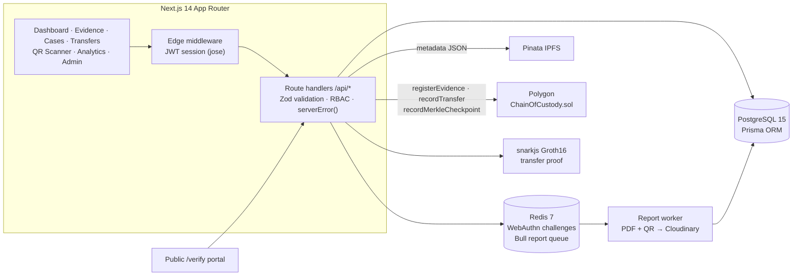

<div align="center">


# ChainProof

**Tamper-evident chain of custody for forensic evidence, anchored on Polygon.**

[](https://github.com/TECHMINEs/ChainProof/actions/workflows/ci.yml)


</div>

ChainProof records every hand-off of a forensic exhibit, from seizure through lab analysis to court, as a cryptographically linked event. Each exhibit is hashed, pinned to IPFS and anchored on Polygon. A tampered record shows up immediately in a three-layer integrity check (database ↔ IPFS ↔ blockchain), which anyone can verify on a public portal.

---

## Architecture



**Repository layout (npm workspaces):** `apps/web` (Next.js app and API), `apps/contracts` (Hardhat and Solidity), `packages/db` (Prisma schema), `packages/crypto` (hashing, Merkle trees, ZK, PDF) and `packages/types` (shared domain types).

## Tech Stack

- **App:** Next.js 14 (App Router, route handlers, Edge middleware), React 18, TypeScript (strict), Tailwind CSS, Recharts, TanStack Query
- **Data:** PostgreSQL 15 via Prisma, and Redis 7 (ioredis) with a Bull job queue
- **Auth:** JWT sessions (jose, httpOnly cookie), bcrypt passwords, WebAuthn passkeys (`@simplewebauthn`) and Ethereum wallet linking
- **Blockchain:** Solidity 0.8.24, OpenZeppelin AccessControl, Hardhat, ethers v6 and Polygon
- **Cryptography:** SHA-256 evidence hashing, Merkle checkpoints, snarkjs Groth16 proofs
- **Integrations:** Pinata (IPFS), Cloudinary (evidence photos and report PDFs), SendGrid (e-mail), Twilio (SMS), html5-qrcode
- **Ops:** Docker Compose (Postgres, Redis and web) and a next-pwa service worker

## Local Setup

**Prerequisites:** Node.js 20+, npm 10+ and Docker Desktop.

```bash
git clone https://github.com/TECHMINEs/ChainProof.git && cd ChainProof
npm install
cp .env.example apps/web/.env.local   # set DATABASE_URL and JWT_SECRET (openssl rand -hex 64)
bash scripts/setup.sh                  # starts Postgres + Redis, pushes the Prisma schema, compiles contracts, seeds the admin
npm run dev                            # http://localhost:3000
```

Other keys are optional. Without Pinata, Polygon, Cloudinary, SendGrid or Twilio credentials, those features degrade gracefully.

**Seeded admin:** Employee ID `ADMIN-001`, password `admin-password-2026`. Change it immediately outside local development.

**Background report worker** (generates certificate PDFs):

```bash
npm run worker
```

**Full stack in Docker:**

```bash
cp .env.example .env
docker compose up --build              # web :3000 · Postgres :5432 · Redis :6379
```

**Smart contracts:**

```bash
cd apps/contracts
npx hardhat test                       # 3 passing
npx hardhat node                       # local chain, in one terminal
npm run deploy                         # deploy, in another; copy the address into CHAIN_OF_CUSTODY_CONTRACT_ADDRESS
```

## Key Features

- **Evidence registration:** each exhibit gets a SHA-256 metadata hash, an IPFS CID, a photo with EXIF/GPS extraction, a QR label and an on-chain `registerEvidence` record.
- **Custody transfers:** a two-party hand-off with a Groth16 proof binding both officers, a combined data hash and on-chain `recordTransfer`.
- **Three-layer integrity verification:** database, IPFS and blockchain are compared, discrepancies are scored, and admins are alerted automatically on tampering.
- **Merkle checkpoints:** batches of evidence hashes are rolled into a single on-chain root.
- **Public verification portal:** anyone can confirm an exhibit's status and blockchain sync via `/verify/:id`, without logging in.
- **Role-based access:** Admin, Officer, Registrar and Auditor roles are enforced in both list and detail endpoints, through one shared access filter.
- **Analytics:** transfers by day, evidence by type, officer activity and anomaly detection.
- **Report PDFs:** certificates of authenticity, with real QR codes that link back to the verification portal.
- **Field use:** an in-browser QR scanner, an installable PWA, and offline scan sync that is validated with Zod.

## Engineering Highlights

- **End-to-end type safety.** TypeScript runs in strict mode. Pages consume the shared `@chainproof/types` domain models, and Prisma `where`/JSON inputs are fully typed, with no `any` in the codebase.
- **WebAuthn byte handling done right.** Credential IDs are persisted as base64url and converted to bytes in a single helper. Passkey options and assertions round-trip correctly with SimpleWebAuthn v9.
- **Least-privilege responses.** User relations are embedded through a shared `publicUserSelect`, so password hashes can never leak into API payloads.
- **Composable access control.** RBAC is expressed as a Prisma filter and combined with search clauses via `AND`, rather than overwriting them.
- **Uniform error contract.** `serverError()` logs the real failure on the server and returns a generic message, so stack traces never reach the client.
- **Contract design.** OpenZeppelin `AccessControl` roles (REGISTRAR, ADMIN), a pausable registry, and on-chain Merkle proof verification.

## Known Limitations

- **ZK proofs fall back to simulation:** the Circom circuit artefacts (`public/zk/transfer.wasm`, `transfer_final.zkey`) are not committed. Until they are generated, transfers store a clearly marked simulated proof.
- **Dashboard transfer acceptance is not cryptographically signed:** it relies on the authenticated session. The passkey and wallet verification paths exist server-side, but there is no UI for passkey registration, wallet linking or signing yet.

---

<div align="center">

Created by **Pranav Jangid** | [**TECHMINES**](https://github.com/TECHMINEs)

</div>
